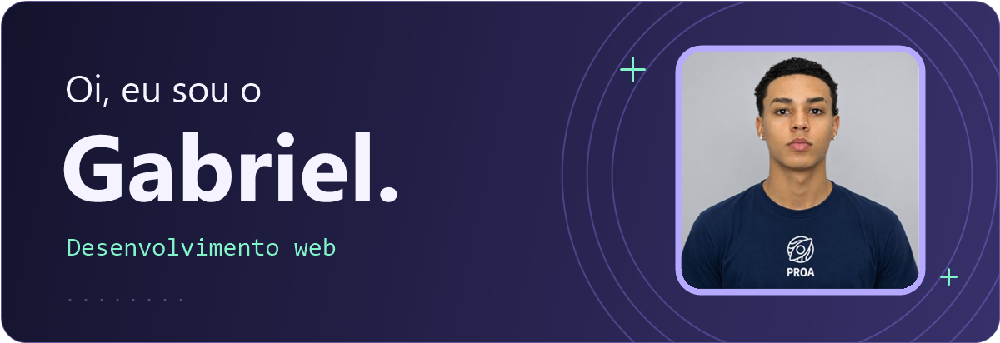

<h1 align="center">
  
</h1>

  <a href="https://github.com/PermaneoOFC/demo-repository"><strong>Permaneo</strong></a>
  &nbsp;·&nbsp;
  <a href="https://www.proa.org.br/">Instituto PROA</a>
  &nbsp;·&nbsp;
  <a href="https://br.linkedin.com/in/gabriel-rodrigues-rgg">LinkedIn</a>

## Sobre mim

Sou **Gabriel Rodrigues Gomes**. Aqui compartilho projetos de desenvolvimento web e o que venho construindo com **JavaScript, React, HTML e CSS**.

## 🌱 Permaneo

O **Permaneo** é um protótipo criado para o Demo Day do Instituto PROA. Ele reúne frequência, desempenho e histórico de acompanhamento para ajudar equipes escolares a identificar sinais de evasão e agir mais cedo.

No projeto, contribuo com o desenvolvimento de interfaces, a documentação e iniciativas de inteligência artificial.

**[Experimente a demonstração ↗](https://permaneo-ofc.vercel.app/)** · [Veja o código no GitHub](https://github.com/PermaneoOFC/demo-repository)

### Escritório Permaneo · Permaneo HQ

Escritório virtual com salas interativas e um painel para acompanhar o andamento do Permaneo e organizar tarefas.

[Veja o repositório do escritório no GitHub](https://github.com/PermaneoOFC/PermaneoOFC-permaneo-hq)

## 🚀 Formação no Instituto PROA

**Instituto PROA** · Formação com prática de desenvolvimento web em equipe.

## Mais projetos

**[Isso Tem Nome](https://github.com/gabrielrgg/Isso-Tem_Nome)** · Exposição digital sobre racismo, transfobia, misoginia e LGBTfobia, com histórias ilustradas e um quiz interativo.

🎸 **[Violão em React](https://github.com/gabrielrgg/Violao-React)** · Projeto web sobre violão desenvolvido com React e Vite.
