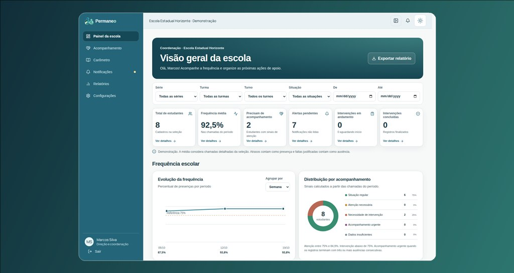
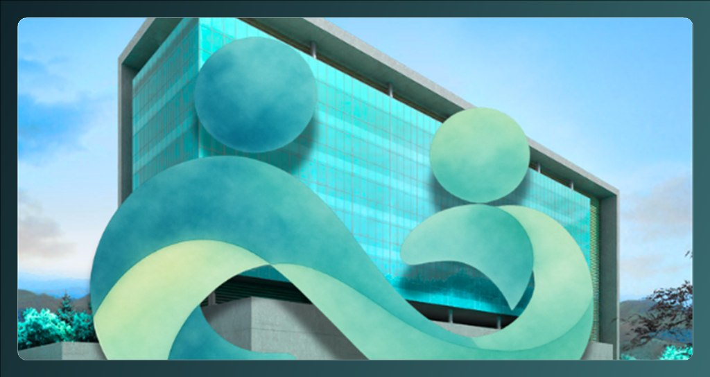
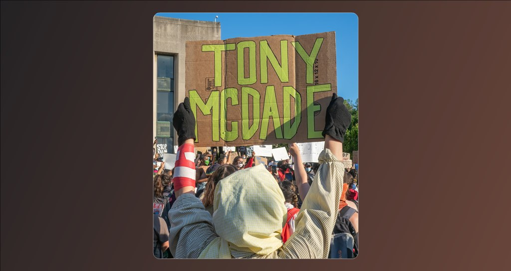
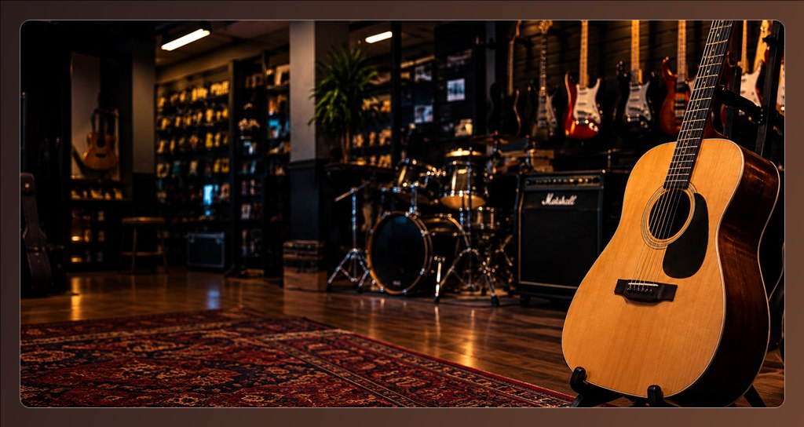

<h1 align="center">
  
</h1>

  <a href="https://github.com/PermaneoOFC/demo-repository"><strong>Permaneo</strong></a>
  &nbsp;·&nbsp;
  <a href="https://www.proa.org.br/">Instituto PROA</a>
  &nbsp;·&nbsp;
  <a href="https://br.linkedin.com/in/gabriel-rodrigues-rgg">LinkedIn</a>

## Sobre mim

Sou **Gabriel Rodrigues Gomes**. Aqui compartilho projetos de desenvolvimento web e o que venho construindo com **JavaScript, React, HTML e CSS**.

## Projetos em destaque

<table>
  <tr>
    <td width="50%" valign="top">
      
      <h3>Permaneo</h3>
      
Protótipo do Demo Day do Instituto PROA para apoiar a prevenção da evasão escolar. Reúne frequência, desempenho e histórico de acompanhamento.

      
Contribuo com interfaces, documentação e iniciativas de inteligência artificial.

      
<a href="https://permaneo-ofc.vercel.app/">Ver demonstração ↗</a> · <a href="https://github.com/PermaneoOFC/demo-repository">Código</a>

    </td>
    <td width="50%" valign="top">
      
      <h3>Escritório Permaneo · Permaneo HQ</h3>
      
Escritório virtual com salas interativas e um painel para acompanhar o andamento do Permaneo e organizar tarefas.

      
<a href="https://permaneo-hq.vercel.app/">Conhecer o escritório ↗</a> · <a href="https://github.com/PermaneoOFC/PermaneoOFC-permaneo-hq">Código</a>

    </td>
  </tr>
  <tr>
    <td width="50%" valign="top">
      
      <h3>Isso Tem Nome</h3>
      
Exposição digital sobre racismo, transfobia, misoginia e LGBTfobia, com histórias ilustradas e um quiz interativo.

      
<a href="https://isso-tem-nome.vercel.app/">Visitar a exposição ↗</a> · <a href="https://github.com/gabrielrgg/Isso-Tem_Nome">Código</a>

      
Foto de <a href="https://commons.wikimedia.org/wiki/File:George_Floyd_rally_in_Grand_Army_Plaza_(02839).jpg">Rhododendrites</a>, redimensionada para o card · <a href="https://creativecommons.org/licenses/by-sa/4.0/">CC BY-SA 4.0</a>

    </td>
    <td width="50%" valign="top">
      
      <h3>Violão em React</h3>
      
Projeto web sobre violão desenvolvido com React e Vite.

      
<a href="https://github.com/gabrielrgg/Violao-React">Ver repositório ↗</a>

    </td>
  </tr>
</table>

## 🚀 Formação no Instituto PROA

**Instituto PROA** · Formação com prática de desenvolvimento web em equipe.
